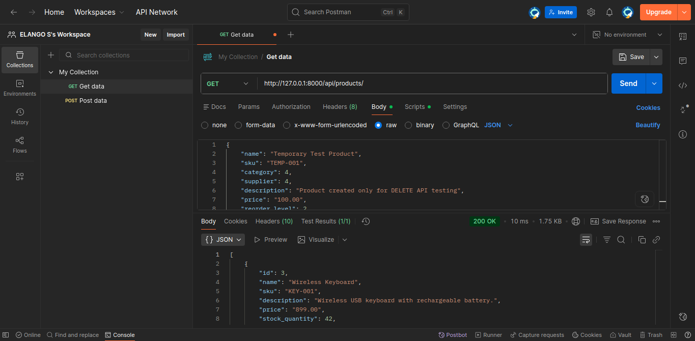
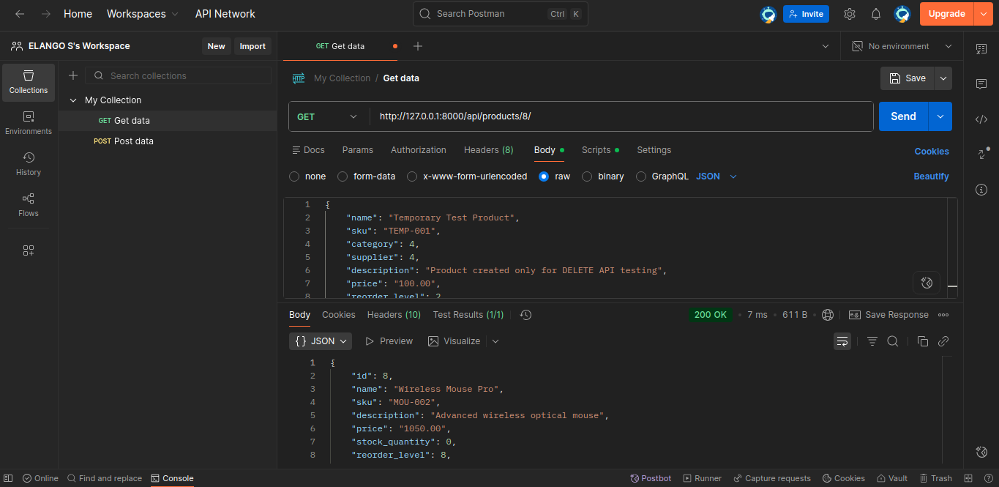
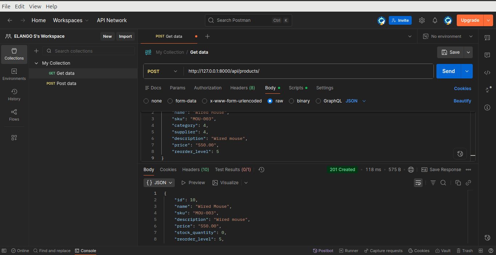
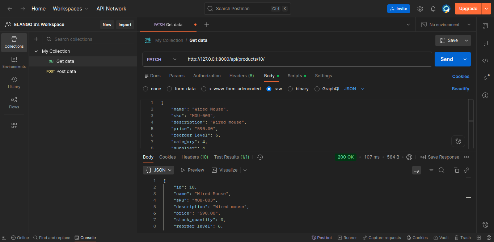
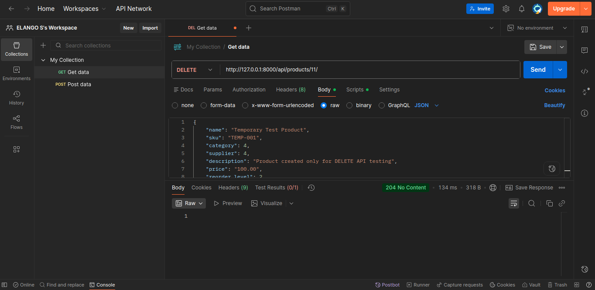

# Warehouse Management System (WMS)

A web-based Warehouse Management System developed using Python, Django, MySQL, HTML, CSS, Bootstrap, and JavaScript.

The application helps warehouse users manage suppliers, product categories, products, and stock transactions through a responsive web interface.

## 1. Project Overview

The Warehouse Management System provides a centralized platform for managing warehouse inventory.

Users can register, log in, manage suppliers and categories, add and update products, record stock-in and stock-out transactions, and monitor inventory levels through a dashboard.

## 2. Technologies Used

### Backend
- Python
- Django

### Frontend
- HTML5
- CSS3
- Bootstrap 5
- JavaScript

### Database
- MySQL

### Development Environment
- Ubuntu Linux
- Visual Studio Code
- Git and GitHub

## 3. Features

### User Authentication
- User registration
- User login and logout
- Authentication-protected dashboard and management pages

### Dashboard
- Total products
- Total suppliers
- Total categories
- Total stock units
- Low-stock product count
- Recent stock transactions

### Supplier Management
- Add suppliers
- View supplier details
- Update supplier information
- Delete unused suppliers
- Prevent deletion of suppliers linked to products

### Category Management
- Add categories
- View categories
- Update categories
- Delete unused categories
- Prevent deletion of categories linked to products

### Product Management
- Add products
- View product details
- Update products
- Delete products
- Search products by name or SKU
- Filter products by category
- Display low-stock status

### Stock Management
- Record stock-in transactions
- Record stock-out transactions
- Automatically update product quantities
- Prevent stock-out quantities exceeding available stock
- Validate duplicate transaction reference numbers

### Transaction History
- View stock-in and stock-out records
- Search by product name or SKU
- Filter by transaction type
- Filter by date range
- Display matching transaction count
- Validate date ranges

### Additional Features
- Responsive interface for mobile and desktop
- Bootstrap navigation bar with active-page highlighting
- Form validation and error messages
- Database relationships using foreign keys

## 4. Project Structure

```text
Warehouse_Management_System/
│
├── Warehouse_config/
│   ├── settings.py
│   ├── urls.py
│   └── wsgi.py
│
├── accounts/
│   ├── forms.py
│   ├── views.py
│   └── urls.py
│
├── inventory/
│   ├── models.py
│   ├── forms.py
│   ├── views.py
│   ├── services.py
│   └── urls.py
│
├── suppliers/
│   ├── models.py
│   ├── forms.py
│   ├── views.py
│   └── urls.py
│
├── templates/
│   ├── base/
│   ├── accounts/
│   ├── inventory/
│   └── suppliers/
│
├── .env
├── .env.example
├── .gitignore
├── manage.py
├── requirements.txt
├── WarehouseDB_backup.sql
├── WarehouseDB_structure.sql
└── README.md
```

## 5. Database Structure

Database name: `WarehouseDB`

Main application tables:

| Table | Purpose |
|---|---|
| `auth_user` | Stores user authentication information |
| `suppliers_supplier` | Stores supplier details |
| `inventory_category` | Stores product categories |
| `inventory_product` | Stores product information and stock quantity |
| `inventory_stockin` | Stores stock-in transactions |
| `inventory_stockout` | Stores stock-out transactions |

Django also creates supporting tables for authentication, permissions, sessions, and migrations.

### Database Relationships

- One supplier can be associated with multiple products.
- One category can contain multiple products.
- One product can have multiple stock-in transactions.
- One product can have multiple stock-out transactions.

## 6. Installation and Setup

### Prerequisites

Install the following software:

- Python 3
- pip
- MySQL Server
- Git

### Step 1

## REST API Integration

The Warehouse Management System includes REST API functionality developed using Django REST Framework (DRF).

These APIs allow applications to communicate with the warehouse system and perform product management operations using HTTP requests and JSON data.

### Product API Endpoints

| HTTP Method | Endpoint | Description |
|---|---|---|
| GET | `/api/products/` | Retrieve all products |
| GET | `/api/products/<id>/` | Retrieve a specific product |
| POST | `/api/products/` | Create a new product |
| PUT | `/api/products/<id>/` | Update product details |
| PATCH | `/api/products/<id>/` | Partially update product details |
| DELETE | `/api/products/<id>/` | Delete a product |

### API Testing

The Product REST APIs have been tested using Postman.

Tested operations:
- Retrieve all products
- Retrieve a single product
- Create a product
- Update product details
- Partially update product details
- Delete a product

### API Response Formats

The API uses JSON (JavaScript Object Notation) for sending and receiving data.

### API Base URL

For local development:

`http://127.0.0.1:8000/api/`

## API Testing Screenshots

### 1. Get All Products


### 2. Get Single Product


### 3. Create Product


### 4. Update Product


### 5. Partial Update Product


### 6. Delete Product


## Postman API Collection

The Postman collection contains API requests for testing
the Warehouse Management System.

**Collection file:**

`postman/REST API basics- CRUD, test & variable.postman_collection.json`

The collection can be imported into Postman to execute and test API endpoints.